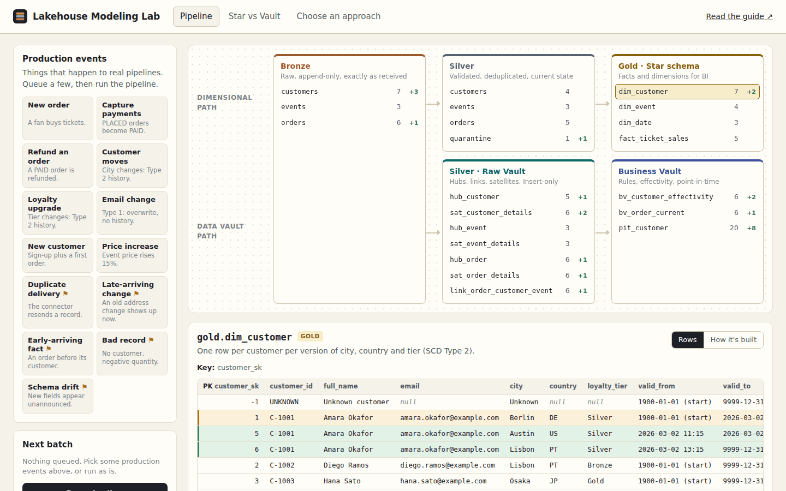

# Lakehouse Modeling Lab

**Data modeling for the lakehouse: Medallion Architecture, Star Schema and Data Vault 2.0 on Databricks, with a guide, runnable notebooks and an interactive playground.**

[](https://aboualyxcode.github.io/lakehouse-modeling-lab/)
[](https://github.com/aboualyXcode/lakehouse-modeling-lab/actions/workflows/test.yml)


One fictional company, Stagedoor (a concert-ticketing platform), modeled three ways from the same raw data. Every concept in the guide has matching Databricks code, and every table in the code can be explored live in the browser.

**[▶ Open the playground](https://aboualyxcode.github.io/lakehouse-modeling-lab/)**



## Contents

- [What's inside](#whats-inside)
- [Quick start](#quick-start)
- [The guide](#the-guide)
- [The playground](#the-playground)
- [The Databricks notebooks](#the-databricks-notebooks)
- [When to use each approach](#when-to-use-each-approach)
- [Repository structure](#repository-structure)
- [Testing](#testing)
- [Deploying the playground](#deploying-the-playground)
- [Credits](#credits)

## What's inside

| | |
|---|---|
| **A guide** | Eight chapters in [`docs/`](docs/): foundations, the Medallion Architecture, star schemas, Data Vault 2.0, Databricks-native patterns, choosing an approach, best practices and an implementation guide, plus a glossary. |
| **Databricks notebooks** | SQL and PySpark notebooks that build Bronze, Silver, a Gold star schema, a Raw Vault and a Business Vault from the same CDC data, then validate both models against each other. |
| **A declarative pipeline** | The same Medallion flow as a single Lakeflow pipeline, with expectations and `AUTO CDC ... SCD TYPE 2`. |
| **An asset bundle** | `databricks.yml` deploys the notebooks as a job and the pipeline, for `dev` and `prod`. |
| **A playground** | A browser app that runs the same pipeline live. Inject late data, duplicates, schema drift or bad records and watch every layer and both models react. |
| **Tests** | 110,000+ checks across hundreds of randomized pipeline runs, run in CI on every push. |

## Quick start

**Explore in the browser:** open the [playground](https://aboualyxcode.github.io/lakehouse-modeling-lab/). Queue a few production events, press **Run pipeline**, and click any table in the lineage diagram.

**Run it on Databricks:** you need a Unity Catalog workspace and serverless compute (or Databricks Runtime 15.4 LTS+).

```sh
git clone https://github.com/aboualyXcode/lakehouse-modeling-lab.git
cd lakehouse-modeling-lab
databricks bundle deploy -t dev --var catalog=<your_catalog>
databricks bundle run lab_notebooks -t dev
```

Or clone it as a Git folder in your workspace and run the notebooks in order, starting with `00_setup`. Everything is created in schemas prefixed `stagedoor_`, so it is safe to run in an existing catalog. See the [implementation guide](docs/08-implementation-guide.md) for details and clean-up.

**Run the playground locally:** open `index.html` in a browser, or serve the folder with `python3 -m http.server 8000`.

## The guide

| Chapter | Covers |
|---|---|
| [1. Foundations](docs/01-foundations.md) | Architecture versus model, grain, business/surrogate/hash keys, history and SCD types, business time versus system time, conformance |
| [2. The Medallion Architecture](docs/02-medallion-architecture.md) | What each layer guarantees, where models fit, Unity Catalog layouts, reprocessing, anti-patterns |
| [3. Star schema](docs/03-star-schema.md) | Kimball's four steps, fact and dimension types, SCD Type 2 three ways, unknown members, late data, OBT, Databricks specifics |
| [4. Data Vault 2.0](docs/04-data-vault-2.md) | Hubs, links, satellites, hash keys and hashdiffs, raw versus business vault, PIT and bridge tables, the out-of-order pitfall, automation |
| [5. Databricks-native patterns](docs/05-databricks-native-patterns.md) | Unity Catalog, Delta features, identity and informational constraints, Auto Loader, Lakeflow pipelines, expectations, AUTO CDC, bundles |
| [6. Choosing an approach](docs/06-choosing-an-approach.md) | Comparison matrix, decision guide, worked scenarios, the hybrid, anti-patterns |
| [7. Best practices](docs/07-best-practices.md) | Naming, keys, time, idempotency, data quality, performance, governance, testing, cost |
| [8. Implementation guide](docs/08-implementation-guide.md) | Running this repository, rolling the approach out to your own domain, project structure, production checklist |
| [Glossary](docs/glossary.md) | Every term used, in one place |

## The playground

Three views, all running in the browser with no backend:

- **Pipeline.** Thirteen production events, from new orders and customer moves to duplicate deliveries, late-arriving changes, early-arriving facts, bad records and schema drift. Run the pipeline and a lineage diagram shows every table's row count and change. Click a table to see its rows, with new, changed and closed versions highlighted, or the Databricks SQL that builds it. A log explains what happened in each layer and why.
- **Star vs Vault.** Three business questions answered from the star schema and from the Business Vault, with both queries and both results side by side. The answers always agree; the SQL shows how differently each model gets there.
- **Choose an approach.** Six questions about your sources, audit needs, consumers, team and timeline produce a ranked, explained recommendation, plus a side-by-side comparison matrix.

The playground implements the same algorithms as the notebooks: SCD Type 2 rebuilt from change history, the MD5 hash keys Spark's `md5()` produces, the business-time satellite comparison, unknown members and zero keys.

## The Databricks notebooks

| Notebook | Layer | Demonstrates |
|---|---|---|
| [`00_setup`](notebooks/00_setup.py) | Landing | Schemas, a Unity Catalog volume, and batch 1 of CDC source files |
| [`01_bronze_ingest`](notebooks/01_bronze_ingest.py) | Bronze | Auto Loader with a pinned schema, a rescued data column and ingestion metadata |
| [`02_silver_conform`](notebooks/02_silver_conform.sql) | Silver | Quality rules with quarantine, idempotent deduplication, change history, current state with a sequence guard |
| [`03_gold_star_schema`](notebooks/03_gold_star_schema.sql) | Gold | Identity surrogate keys, SCD Type 2 that survives late data, unknown members, informational PK/FK with `RELY`, liquid clustering |
| [`04_raw_vault`](notebooks/04_raw_vault.py) | Silver | Metadata-driven hubs, links and satellites; zero keys; business-time hashdiff comparison |
| [`05_business_vault`](notebooks/05_business_vault.sql) | Silver/Gold | Soft rules, effectivity, a PIT table, and star views over the vault |
| [`06_validate`](notebooks/06_validate.sql) | All | Key, SCD and referential-integrity tests, and star-versus-vault reconciliation |
| [`07_land_next_batch`](notebooks/07_land_next_batch.py) | Landing | Batches 2 and 3: a move, a duplicate, a late change, a bad record, schema drift, an early-arriving order |
| [`medallion_pipeline.sql`](pipelines/medallion_pipeline.sql) | All | The declarative version: streaming tables, expectations, `AUTO CDC` SCD Types 1 and 2, materialized views |

After batch 2, Amara's customer history reads Berlin → Austin → Lisbon, with the late Austin record inserted in the middle. Her first order still counts in Berlin, and the star schema and the vault agree. The [implementation guide](docs/08-implementation-guide.md#what-to-look-at) lists what to check after each batch.

## When to use each approach

| If you need… | Choose |
|---|---|
| Fast, simple analytics on a few sources | **Star schema** in Gold |
| Integration of many changing sources with full audit | **Data Vault** in Silver, star schemas in Gold |
| One dashboard by Friday | A **wide Gold table**, refactored later |
| Reprocessing, quality layers and governance | **Medallion**, always |
| Incremental SCD Type 2 with minimal code | **`AUTO CDC`** in a declarative pipeline |

Medallion is an architecture; star schemas and Data Vault are models that live inside its layers. The real decision is what goes in Silver and what goes in Gold. [Chapter 6](docs/06-choosing-an-approach.md) covers it in depth.

## Repository structure

```
index.html, css/, js/          the playground (no build step, no dependencies)
  js/model.js                  source system, Medallion layers, star schema, Data Vault, business questions
  js/sql.js                    the Databricks SQL shown for each table, excerpted from the notebooks
  js/advisor.js                the approach advisor and comparison matrix
  js/md5.js                    MD5 identical to Spark's md5(), for hash keys
docs/                          the guide
notebooks/                     Databricks notebooks (SQL and PySpark, source format)
pipelines/                     the declarative pipeline
databricks.yml                 Databricks Asset Bundle: job and pipeline
tests/model.test.js            model tests (Node.js, no dependencies)
```

## Testing

```sh
node tests/model.test.js
```

The suite runs four groups of checks:

1. **Hashing:** hash keys match Node's MD5, the same function Spark implements.
2. **Scenarios:** duplicates, moves, Type 1 changes, late data, early-arriving facts, bad records, schema drift and price changes.
3. **Randomized runs:** 60 seeds × 14 pipeline runs of random production events. After every run it checks invariants:
   - SCD Type 2 history is contiguous, with one current version per key;
   - surrogate keys are stable, and every foreign key resolves;
   - satellites never store a change twice;
   - Silver never moves backwards;
   - the star schema and the vault give identical answers.
4. **Content:** the advisor ranks sensibly, and every playground table's SQL snippet points at a notebook that exists.

These randomized runs caught a real Data Vault bug during development: a late-arriving change with the same values as a newer one was silently dropped. [Chapter 4](docs/04-data-vault-2.md#the-out-of-order-pitfall) explains it.

The notebooks include their own validation (`06_validate`), which runs on Databricks after every load.

## Deploying the playground

The playground is served by GitHub Pages from the `main` branch. To host your own copy:

1. Fork the repository, or push it to an empty public repository of your own.
2. Open **Settings → Pages**, set **Source** to **Deploy from a branch**, choose `main` and `/ (root)`, and save.
3. After a minute or two it is live at `https://<your-username>.github.io/<repository-name>/`.

## Credits

Created by [Mahmoud Aboualy](https://github.com/aboualyXcode). Part of a series with [Desired State](https://github.com/aboualyXcode/k8s-desired-state) and [Blast Radius](https://github.com/aboualyXcode/k8s-blast-radius).

Typefaces: IBM Plex Sans and IBM Plex Mono from Google Fonts, with system fonts as an offline fallback. Stagedoor and its customers are fictional.

Databricks, Delta Lake, Unity Catalog and Lakeflow are trademarks of Databricks, Inc. Data Vault is associated with Dan Linstedt; dimensional modeling with Ralph Kimball. This project is independent and not affiliated with or endorsed by any of them.
